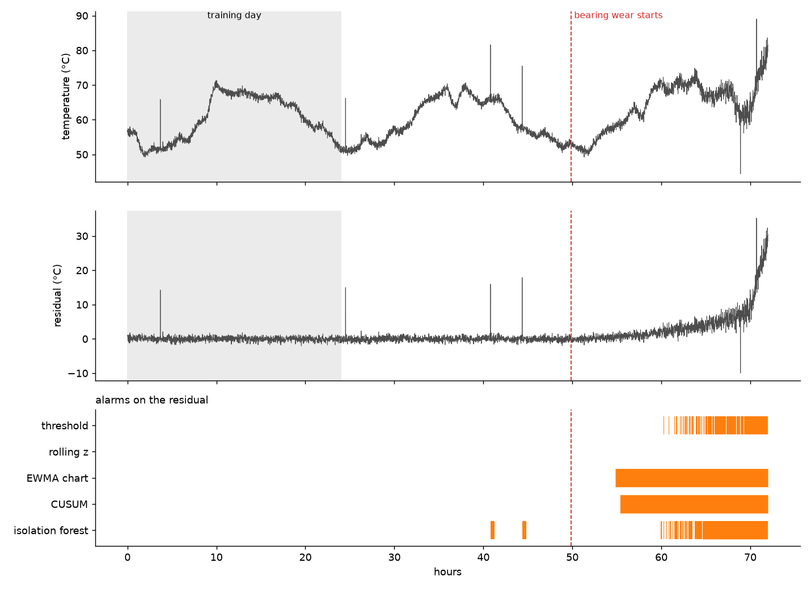

# sensor-anomaly-detection

*Built with the help of Claude Code.*

How early can you tell that a motor is about to fail, just from its
temperature sensor, without drowning the operator in false alarms?

This repo simulates three days of motor data per run: temperature and current
every minute, a daily load cycle, random load changes, a few sensor glitches,
and a bearing that starts wearing out at a random point. It then compares
five detectors, from a fixed threshold to an isolation forest, across 40 runs.



## Results (40 simulated runs)

The detectors run either on the raw temperature or on the **residual**:
measured temperature minus the temperature a small regression expects from
the current motor load.

| detector | input | false alarms / day | faults caught | median warning before overheating |
|---|---|---:|---:|---:|
| threshold (mean + 3 sd) | raw | 0.00 | 0 % | - |
| threshold (mean + 3 sd) | residual | 0.00 | 100 % | 10.9 h |
| rolling z-score | residual | 0.00 | 0 % | - |
| EWMA control chart | residual | 0.09 | 100 % | 16.8 h |
| CUSUM | raw | 1.18 | 100 % | 21.6 h |
| CUSUM | residual | 0.00 | 100 % | 14.9 h |
| isolation forest | residual | 0.81 | 82 % | 11.5 h |

Full table: `python -m anomaly.evaluate`.

What I took from it:

1. **Model the normal, then watch what's left.** On raw temperature, a
   threshold wide enough to survive the daily load swing is also wide enough
   to miss a slowly heating bearing. Subtracting the load-driven part turns
   a 20 °C swing into about ±1 °C of noise, and every detector gets better.
2. **Detectors that adapt to the data miss slow faults.** The rolling z-score
   compares each reading to the last two hours. A bearing that heats up over
   a day never looks unusual against its own recent past.
3. **Accumulating detectors (EWMA, CUSUM) buy several hours of warning.** They
   add up small, persistent deviations that no single reading shows. CUSUM
   on raw data warns earliest, but at more than one false alarm a day that
   is not worth it.
4. **The ML model wasn't the best tool here.** The isolation forest flags
   glitches and misses some faults. With one sensor and a known failure mode,
   a control chart is simpler, easier to explain to a maintenance team, and
   better.

Two fixes came from looking at plots, not tables. The EWMA chart first raised
about one false alarm a day. Its textbook limit assumes independent
readings, and sensor data isn't independent, so the limit is now calibrated
on the training day. A single 20 °C glitch also kept the average raised for
an hour, so readings are now capped at 4 sd before averaging.

## How it works

```
src/anomaly/
  simulate.py    motor model: load -> current, lagged temperature, bearing wear, glitches
  detectors.py   ExpectedTemperature (the residual model) and the five detectors
  evaluate.py    runs every detector on every run, scores it, draws the figure
```

Every detector is `fit` on the first day, which is assumed healthy, and then
flags readings using only data up to the current reading, so all of them
would work on a live stream. An alarm needs three flagged readings in a row,
which removes single-sample glitches.

Scoring, per run:
- *false alarms / day*: separate alarm episodes between the end of the
  training day and the start of bearing wear
- *caught*: an alarm between the start of wear and the start of overheating
- *warning*: hours from that first alarm to the start of overheating

## Run it

```
pip install -e .[dev]
python -m anomaly.evaluate --plot
pytest
```

## Where this started

This began as my first Python exercise: generate 500 fake temperature
readings, flag everything above mean + 2 sd, plot it. That worked on the
fake data and would have failed on any real motor, because real motors
change load. This repo is the follow-up: what it takes to make that idea
hold up.

## Limitations

- The data is simulated. The failure mode (friction heat that grows over time,
  plus more noise) is plausible but simplified. Real bearing wear shows up
  earlier in vibration than in temperature.
- Detector parameters were set once and not tuned per run. With real data,
  you would tune them to a false-alarm budget agreed with the plant.
- The residual model is linear in the smoothed current. A motor with a
  cooling fan that switches on and off would need more than that.
